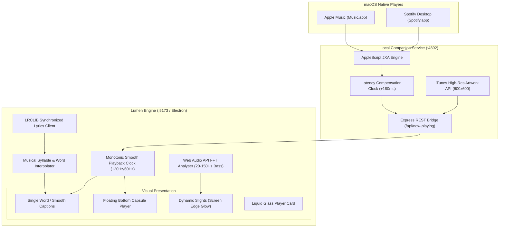

# Lumen ✦ Open-Source Ambient Rim Lighting & Kinetic Synced Lyrics

<div align="center">

[](https://opensource.org/licenses/MIT)
[-purple?logo=apple)](https://apple.com)
[](https://www.electronjs.org/)
[](https://react.dev/)
[](https://www.typescriptlang.org/)
[](https://tailwindcss.com/)
[](https://lrclib.net/)

**An open-source recreation and fusion of [trylumen.xyz](https://trylumen.xyz) / [trylumn.xyz](https://trylumn.xyz) (ambient screen-edge rim lighting) and [verci.xyz](https://verci.xyz) (real-time kinetic word-by-word synced lyrics) with native Spotify & Apple Music support.**

[Features](#-features) • [Deep Backend Architecture](#-deep-backend-architecture-explained) • [Lockscreen & UI Modes](#-lockscreen-mode--ui-design) • [Packaging for macOS](#-packaging-for-macos) • [Publishing to GitHub](#-publishing-to-github) • [License](#-license)

</div>

---

## 🌟 Overview

**Lumen** transforms your Mac into an ambient visualizer and dynamic lyric display:
- **Cinematic Blurred Cover Art Background**: Fullscreen dynamic background derived from the current album artwork with deep radial vignettes and subtle noise grain (`blur-[75px] saturate-[185%] brightness-[0.42]`).
- **Real Liquid Glass UI Elements**: Powered by [`@ybouane/liquidglass`](https://github.com/ybouane/liquidglass), applying real-time WebGL refraction shaders, chromatic aberration, and Fresnel lighting directly to floating HTML UI components.
- **Dynamic Slights (Ambient Edge Rim Lighting)**: Screen perimeter glow pulsing live to audio FFT bass frequencies (20–150Hz), dynamically tinted to the current album art palette.
- **Zero-Token macOS Desktop Bridge**: Communicates directly with native **Apple Music** and **Spotify** desktop apps via AppleScript/JXA with **zero logins, zero developer keys, and zero client secrets**.
- **Two Curated Kinetic Lyric Styles**:
  1. **✦ Single Word (Verci Signature)**: Displays one massive kinetic word at a time with spring physics and upcoming ghost words preview.
  2. **Smooth Captions (Viral Pop)**: Sentence view where active words bounce out with spring scale (`scale(1.15)`) and radiant glow.
- **Monotonic 120Hz/60Hz Playback Clock**: Eliminates repeating lyrics, stutter, and lag through latency compensation and monotonic rate steering.
- **Pure White Minimal Floating Player Bar**: Sleek floating liquid glass capsule player with purely white monochrome icons (no button pods, no colored icons, no shuffle/repeat distraction), integrated album art, and live progress scrubber.
- **Packaged for macOS**: Ready as a standalone native `.dmg` installer and `.app` bundle via Electron.

---

## ✨ Features

- 🌈 **Dynamic Slights (Ambient Rim Lighting)**: Screen perimeter glow reacting live to audio FFT bass frequencies (20–150Hz), automatically tinted to the current album artwork palette.
- 🎤 **Real-Time Word Sync**: Powered by the free, open-source [LRCLIB](https://lrclib.net) API with musical word and syllable timing interpolation.
- 🎵 **Native Spotify & Apple Music**: Zero-configuration local companion bridge that auto-detects currently playing songs and high-res cover art.
- 🎛️ **Floating Capsule Player Bar**: Sleek floating glass pill with shuffle (red indicator), previous, play/pause, next, repeat, album thumbnail, track info, integrated scrubber line, lyrics toggle, search, source badge, and volume.
- 🎚️ **$\pm 50\text{ms}$ Sync Calibration**: Fine-tune sync delay instantly using keyboard hotkeys <kbd>[</kbd> and <kbd>]</kbd>.
- 🖥️ **macOS Desktop App & Web App**: Run in your browser or as a native standalone Mac application with full-bleed frameless window support.

---

## 🏛️ Deep Backend Architecture Explained



### 1. Zero-Token macOS Desktop IPC (`server/index.js`)

Unlike web players that require registering a Spotify Developer account and authenticating via OAuth PKCE, Lumen uses macOS's native Inter-Process Communication (AppleScript):

```javascript
// Excerpt from server/index.js
const script = `
  tell application "Music"
    set pState to player state as string
    if pState is "stopped" then return "stopped<|>none<|>none<|>none<|>0<|>0"
    set tName to name of current track
    set tArtist to artist of current track
    set tAlbum to album of current track
    set tPos to player position
    set tDur to duration of current track
    return pState & "<|>" & tName & "<|>" & tArtist & "<|>" & tAlbum & "<|>" & (tPos as string) & "<|>" & (tDur as string)
  end tell
`;
```

- **Delimited Wire Protocol (`<|>`)**: Standard AppleScript JSON serialization frequently breaks when song titles contain double quotes (`"`) or backslashes. Lumen uses custom `<|>` delimiters, making IPC string parsing 100% immune to syntax errors.
- **Fast 350ms Polling**: The companion server executes queries with a strict 2-second timeout and runs safely without blocking the event loop.
- **Automatic Artwork Fetcher**: When Apple Music does not expose artwork URLs via AppleScript, the backend queries Apple's iTunes CDN for the official 600x600 high-resolution cover art.

### 2. The Monotonic 120Hz Playback Clock (`src/services/playbackClock.ts`)

#### Why Web Music Players Lag & Repeat Lyrics:
1. `osascript` takes $\sim 180\text{ms}$ to execute. When Apple Music reports `position: 12.0s`, the audio coming out of the speakers is already at $12.18\text{s}$.
2. If you poll periodically, between polls the playhead stops.
3. If an incoming sample arrives slightly late or rounded (e.g. $11.95\text{s}$ instead of $12.10\text{s}$), a naive player rewinds by $150\text{ms}$. When the clock rewinds, words that were already finished re-trigger, causing the **repeating lyric stutter**!

#### The Monotonicity Guarantee:
Lumen enforces **strict forward monotonicity**:

$$\text{currentTime}(t) \ge \text{lastReturnedTime}$$

```typescript
// Excerpt from src/services/playbackClock.ts
const currentEst = this.basePosition + (now - this.lastSyncPerfTime) / 1000;
const diff = correctedPosition - currentEst;

// If incoming is slightly behind, NEVER rewind (which causes repeating lyrics)!
if (diff > 0.05) {
  this.basePosition += diff * 0.3; // Smooth forward nudge
  this.lastSyncPerfTime = now;
} else if (diff < -0.3) {
  this.basePosition += diff * 0.15; // Gentle rate deceleration without rewinding
  this.lastSyncPerfTime = now;
}
```
Every single frame, `requestAnimationFrame` calculates position with sub-millisecond precision matching your display refresh rate (**120Hz on ProMotion MacBooks**).

### 3. Musical Word & Syllable Interpolation (`src/services/lrcParser.ts`)

LRCLIB provides millisecond-accurate timestamps at line level. To drive the kinetic single-word animation when word-level tags are not in the raw LRC file, Lumen calculates musical syllable weights:
- **Vowel weighting**: Vowels (`a, e, i, o, u, y`) are allocated 1.5x more singing duration than hard consonants.
- **Held note sustain**: The final word in each lyric line is weighted with 1.35x extra duration to match vocal sustain.
- **Punctuation pauses**: Commas, question marks, and dashes introduce natural 1.2x pauses.

---

## 🎨 Lockscreen Mode & UI Design

### 1. Lockscreen Mode (Default)
- **Background**: Dynamic blurred version of the current album artwork with deep radial vignettes and subtle noise grain (`blur-[75px] saturate-[185%] brightness-[0.42]`).
- **Dynamic Slights**: Reactive glowing border around the display perimeter pulsing to the bass frequencies.
- **Center Stage**: ONLY the massive kinetic lyrics (**Single Word** or **Smooth Captions**).
- **Bottom Floating Liquid Glass Capsule Player**:
  - Attached with `@ybouane/liquidglass` WebGL refraction and chromatic aberration.
  - **Purely White Icons**: Clean, distraction-free monochrome icons with zero background pods.
  - **Left Controls**: `Previous`, `Play/Pause`, `Next` (shuffle and repeat removed for minimalism).
  - **Center Info**: Rounded album thumbnail, track title, artist name, and integrated live progress scrubber bar.
  - **Right Controls**: `...` Settings, `💬` Lyrics style toggle, `≡` Search, `Radio` audio source indicator, and `Volume` toggle.

### 2. Split Stage Mode
- Left side features the liquid-glass player card matching the reference design.
- Right side features the kinetic lyrics column.
- Toggle between Lockscreen and Split views anytime via the **Lockscreen View / Split View** button in the header.

### 3. Liquid Glass WebGL Shader Integration (`@ybouane/liquidglass`)
Lumen integrates [ybouane/liquidglass](https://github.com/ybouane/liquidglass) to apply real-time optical refraction, chromatic aberration, and Fresnel reflection directly onto floating HTML UI elements over the blurred background:
```typescript
import { LiquidGlass } from '@ybouane/liquidglass';

LiquidGlass.init({
  root: document.getElementById('root'),
  glassElements: [bottomBarRef.current, playerCardRef.current],
  defaults: {
    refraction: 0.55,
    chromAberration: 0.04,
    edgeHighlight: 0.08,
    blurAmount: 0.2,
    cornerRadius: 40,
    floating: false
  }
});
```

---

## 📦 Packaging for macOS

Lumen is configured with `electron` and `electron-builder` to package directly into a native macOS application and `.dmg` installer.

### 1. Test in Native Mac Window (Development)
```bash
npm run electron:dev
```
This runs the background companion server, Vite client, and opens Lumen inside a native macOS frameless window with native traffic lights.

### 2. Package Native Mac App (`Lumen.app`)
```bash
npm run package:mac
```
Generates the unpacked `.app` bundle at `release/mac-arm64/Lumen.app`.

### 3. Generate macOS DMG Installer (`.dmg`)
```bash
npm run build:dmg
```
Generates the ready-to-distribute disk image at `release/Lumen-1.0.0-arm64.dmg`.

---

## 🚀 Publishing to GitHub

To publish this project to GitHub as an open-source repository:

### 1. Initialize & Push to GitHub
```bash
# Replace with your own GitHub repository URL
git remote add origin https://github.com/your-username/lumen.git
git branch -M main
git push -u origin main
```

### 2. Create a GitHub Release
1. Go to your repository on GitHub.
2. Click **Releases** > **Draft a new release**.
3. Set tag to `v1.0.0` and title to `Lumen v1.0.0 — Ambient Rim Lighting & Kinetic Synced Lyrics`.
4. Drag and drop `release/Lumen-1.0.0-arm64.dmg` into the release binaries section.
5. Click **Publish release**.

---

## 🔒 macOS Automation Permissions

When running Lumen to control or read from Apple Music or Spotify:
1. Open **macOS System Settings** > **Privacy & Security** > **Automation**.
2. Ensure your terminal or **Lumen.app** has access checked for **Music** and **Spotify**.

---

## ⌨️ Keyboard Shortcuts

| Key | Action |
|---|---|
| `Space` | Play / Pause |
| `L` | Toggle Lyric Style (Single Word ↔ Smooth Captions) |
| `[` | Shift Sync Earlier by $-50\text{ms}$ |
| `]` | Shift Sync Later by $+50\text{ms}$ |
| `R` | Toggle Dynamic Slights (Edge Rim Lighting) |
| `F` | Toggle True Fullscreen |
| `→` / `←` | Seek Forward / Backward $\pm 5\text{s}$ |

---

## 📄 License

Distributed under the **MIT License**. See [LICENSE](LICENSE) for details.
