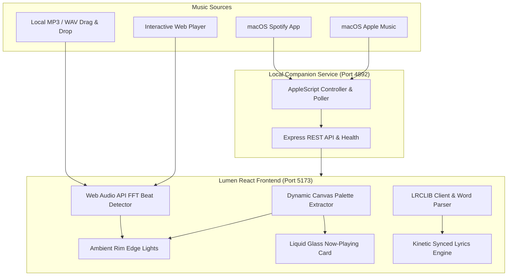

# Lumen ✦ Open-Source Ambient Rim Lighting & Kinetic Synced Lyrics

<div align="center">

[](https://opensource.org/licenses/MIT)
[](https://www.typescriptlang.org/)
[](https://react.dev/)
[](https://tailwindcss.com/)
[](https://lrclib.net/)
[](https://apple.com)

**An open-source recreation and fusion of [trylumn.xyz](https://trylumn.xyz) (ambient screen-edge lighting) and [verci.xyz](https://verci.xyz) (real-time kinetic word-by-word synced lyrics) with Spotify and Apple Music integration.**

</div>

---

## 🌟 Overview

**Lumen** turns your Mac screen or web browser into an ambient visualizer and dynamic lyric stage:
1. **Screen-Edge Ambient Rim Lighting**: Emits a responsive, dynamic glow around the perimeter of your display matching the dominant color palette of the playing song's album art. Pulses dynamically to audio bass frequencies.
2. **Liquid-Glass Now Playing Card**: A frosted glass player widget with specular highlights, breathing vinyl artwork, playback controls, and live 2-line mini lyric preview.
3. **Kinetic Synced Lyric Engine**: Powered by [LRCLIB](https://lrclib.net), providing real-time, word-by-word and line-by-line synchronized lyrics with Apple Music-grade typography and 3D perspective wall views.
4. **Spotify & Apple Music "Now Playing"**: Zero-configuration macOS desktop bridge using AppleScript to detect what is playing in the native Spotify or Apple Music desktop apps in real-time.

---

## ✨ Features

### 1. 🌈 Screen-Edge Ambient Rim Lighting (`trylumn.xyz`)
- **5 Animation Modes**:
  - `Aurora`: Organic continuous rotating ambient wave.
  - `Pulse`: Audio beat-reactive pulsing that tracks sub-bass frequencies (20-150Hz).
  - `Wave`: Smooth perimeter tide flowing around top, right, bottom, and left borders.
  - `Liquid`: Shimmering fluid specular light pools.
  - `Static`: Clean, distraction-free ambient backlight.
- **Dynamic Palette Extraction**: HTML5 Canvas algorithm samples pixels from album art to extract dominant, secondary, accent, and glow tones.
- **Palette Presets**: Auto Album Art, Neon Cyberpunk, Sunset Crimson, Deep Indigo, Emerald Forest, Warm Amber, OLED Monochrome.
- **Precision Sliders**: Rim thickness (4–48px), glow diffusion (10–100px), intensity (20–180%), and beat sensitivity.

### 2. 🎤 Real-Time Kinetic Synced Lyrics (`verci.xyz` + `LRCLIB`)
- **Direct LRCLIB Integration**: Fetches synced `.lrc` and word-level timing from `https://lrclib.net` without requiring any API keys.
- **Word-by-Word Smooth Sweeps**: Progressive text shading as each word or syllable is sung.
- **3 Visual Styles**:
  - `Cinematic Flow`: Apple Music style with fluid typography and depth-of-field blur on past and upcoming lines.
  - `Verci 3D Wall`: Perspective tilted 3D wall of lyrics (`perspective: 1000px`, `rotateX: 12deg`).
  - `Focus Line`: Minimalist single massive active line with upcoming line preview.
- **Interactive Click-to-Seek**: Click any lyric line to jump playback directly to that timestamp.
- **Auto-Scroll Physics**: Automatically keeps the current line centered; pauses smoothly when the user manually scrolls.
- **Sync Calibration Slider**: Adjust offset from -3.0s to +3.0s in 100ms steps to compensate for audio latency.

### 3. 🎵 Spotify & Apple Music Integrations
- **Zero-Login macOS Desktop Bridge**: Runs a lightweight local Express service (`server/index.js`) that uses native AppleScript to read the playback state of Spotify or Music.app every second.
- **Full Media Controls**: Play, pause, skip, seek, and toggle repeat/shuffle directly from the Lumen interface.
- **Interactive Demo Mode**: Includes 5 pre-loaded hit tracks (*Blinding Lights*, *Starboy*, *As It Was*, *Levitating*, *STAY*) with high-res artwork, audio previews, and synced lyrics.
- **Local Audio File Dropzone**: Drag and drop any `.mp3`, `.wav`, `.flac`, or `.m4a` file; Lumen extracts metadata and automatically queries LRCLIB for the lyrics!
- **Global Track Search**: Search any song across global catalogs and pair with LRCLIB with 1 click.

---

## 🏗️ Architecture



---

## 🚀 Quickstart

### Prerequisites
- [Node.js](https://nodejs.org/) v18+ (tested on v22)
- macOS (for native Apple Music / Spotify desktop integration) or any OS (for Web/Local Audio mode)

### 1. Clone & Install
```bash
git clone https://github.com/your-username/lumen.git
cd lumen
npm install
```

### 2. Run Companion Server & Frontend Concurrently
```bash
npm run start
```
This runs both:
- **Lumen Frontend**: `http://localhost:5173`
- **macOS Companion Bridge**: `http://localhost:4892`

Or run them individually:
```bash
# Terminal 1: macOS Bridge
npm run server

# Terminal 2: Vite Web Client
npm run dev
```

---

## ⌨️ Keyboard Shortcuts

| Key | Action |
|---|---|
| `Space` | Play / Pause |
| `F` | Toggle True Fullscreen mode |
| `L` | Cycle Lyric View Style (Cinematic ↔ 3D Wall ↔ Focus Line) |
| `R` | Toggle Screen-Edge Rim Lighting On / Off |
| `→` | Seek Forward (+5 seconds) |
| `←` | Seek Backward (-5 seconds) |
| `Esc` | Close Modals / Exit Fullscreen |

---

## 🔒 macOS Automation Permissions Guide

To allow the companion server to read the now-playing track from Spotify or Apple Music without popups:
1. Open **System Settings** on your Mac.
2. Navigate to **Privacy & Security** > **Automation**.
3. Under your terminal app (e.g. *Terminal*, *iTerm*, *VS Code*, or *Antigravity*), ensure the toggles for **Music** and **Spotify** are checked.

---

## 📂 Project Structure

```
├── server/
│   └── index.js              # macOS AppleScript companion server (Spotify & Apple Music)
├── src/
│   ├── components/
│   │   ├── AmbientRimLights.tsx   # Screen-edge glow visualizer (trylumn.xyz)
│   │   ├── LiquidGlassPlayer.tsx  # Frosted glass now-playing card
│   │   ├── SyncedLyricsView.tsx   # Kinetic word-by-word lyric engine (verci.xyz)
│   │   ├── DynamicIsland.tsx      # Minimal floating island pill
│   │   ├── ControlsModal.tsx      # Settings & customization panel
│   │   ├── TrackSearchModal.tsx   # Search any track on LRCLIB & iTunes
│   │   └── VisualizerCanvas.tsx   # Dynamic ambient background mesh
│   ├── services/
│   │   ├── lrclib.ts              # LRCLIB API client & caching
│   │   ├── lrcParser.ts           # LRC parser & word interpolation
│   │   ├── colorExtractor.ts      # Canvas palette extraction & presets
│   │   ├── audioManager.ts        # Web Audio API FFT & demo tracks
│   │   └── macosBridge.ts         # Client communication with local bridge
│   ├── types/
│   │   └── index.ts               # Core TypeScript definitions
│   ├── App.tsx                    # Main container application
│   ├── index.css                  # Tailwind CSS v4 & glassmorphism styles
│   └── main.tsx                   # React root mount
├── package.json
├── vite.config.ts
└── LICENSE                        # MIT License
```

---

## 📄 License

Distributed under the **MIT License**. See [LICENSE](LICENSE) for more information.

---

## ❤️ Acknowledgements & Credits

- [trylumn.xyz](https://trylumn.xyz) for the ambient screen-edge lighting concept.
- [verci.xyz](https://verci.xyz) for the word-by-word kinetic lock-screen lyrics inspiration.
- [LRCLIB](https://lrclib.net) for their public synchronized lyrics database and API.
